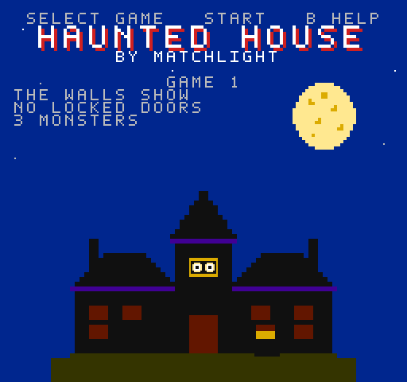
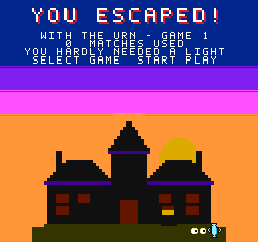
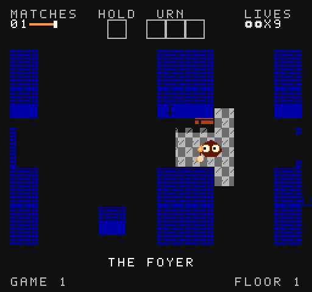
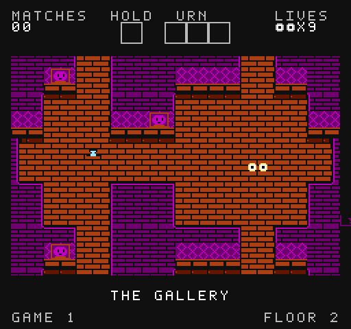
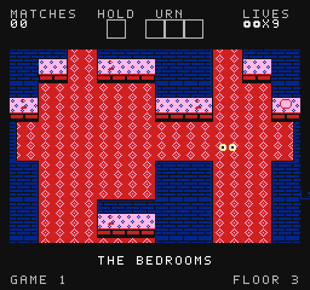
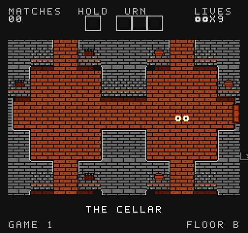

# Haunted House: By Matchlight

A native NES game of the Atari 2600 *Haunted House* (James Andreasen, 1982): the same game, rule for rule, in a new and bigger
mansion - a cellar and four floors - drawn the way the [Haunted House remaster](https://github.com/majonesmax/haunted-house-remastered)'s
NES look draws it. It runs on any NES emulator, or a real NES with an MMC3 cartridge.

**[▶ Play it in your browser](https://majonesmax.github.io/haunted-house-nes/)** - nothing to install.

<p>
  
  
</p>
<p>
  
  
</p>
<p>
  
  
</p>

The title; the ending, out at dawn; the Foyer as you play it, by matchlight; and three floors with the
lights-on cheat on, so the whole floor shows - the Gallery, the Bedrooms and the Cellar.

**Download** the ROM from the [releases](../../releases): `haunted_house.nes`, or `haunted_house_ambient.nes`,
the same game with no tunes on the floors - only the house and what haunts it (a hum, wind, a far-off music
box, knocking, footsteps above... and now and then something worse). The browser page plays either.

Find the three pieces of the urn and carry the whole urn out of the front door, in the dark, with only
matches to see by, while a ghost, a bat and tarantulas roam the house. Nine games, from easy to hard, as the
original has them.

## Playing

| Button | |
|---|---|
| D-pad | walk |
| A | light a match; put down what you hold |
| Start | start a game (RESET) |
| Select | choose the game, 1-9 |
| B | on the title, the help; in play, a hint: what to look for next, and which way |
| B + Select | the lights-on cheat: every room lit, everything on the floor shown |

The house: the Cellar, the Foyer (with the front door), the Gallery, the Bedrooms and the Attic - each floor
with its own rooms, doors, locks and stairs, and in game 9, other stairs and locks again. The status band
shows the Cellar as floor B.

## How it's made

- **The rules** are the remaster's [specification](https://github.com/majonesmax/haunted-house-remastered/blob/main/docs/spec.md)
  of the original, and its model of the whole game, which predicts the original's every byte on every frame.
  The engine is written from them in 6502 assembly (`src/`), not from the original's code.
- **The check** plays the ROM in an emulator beside the model, with the same controls, and compares the
  game's state after every frame: `tests/verify_engine.py`. It's exact, and no frame ever runs late.
- **The mansion** is drawn as text (`mansion/floors.txt`); `tools/check_mansion.py` checks it plays as the
  original does - monsters never walk through walls, stairs meet, and every room can be reached without the
  master key, in every game.
- **The art and music** are our own and the remaster's classic pack's, drawn as text art
  (`mansion/art.py`, `mansion/music.json`).

There's a second build, the **faithful** one, with the original's own mansion read from your copy of the 2600
game when you build it. It proves the engine plays exactly like the original; it's never shared, and nothing
from the 2600 game is in this repository or in the shareable ROM.

[The plan](docs/plan.md) has the whole story, step by step.

## Building

```sh
brew install cc65                        # or apt install cc65, or https://cc65.github.io
python3 -m venv .venv && .venv/bin/pip install -r requirements-dev.txt
git clone https://github.com/majonesmax/haunted-house-remastered ../haunted-house   # beside this one
.venv/bin/python tools/build.py --shareable   # build/shareable/haunted_house.nes
.venv/bin/python tools/build.py --shareable --ambient   # ...and haunted_house_ambient.nes
.venv/bin/python tools/get_core.py            # the FCEUmm core, for the checks
.venv/bin/python tests/verify_engine.py --shareable   # it plays exactly as the model says
```

**The faithful build** - the original's own mansion, built from your copy of the 2600 game (the NTSC
cartridge, MD5 `f0a6e99f5875891246c3dbecbf2d2cea`) and never shared: [docs/faithful-build.md](docs/faithful-build.md)
has the recipe, step by step. In short: your ROM at `../haunted-house/roms/haunted_house.a26`, then
`.venv/bin/python tools/build.py`.

## License

The code is MIT (`LICENSE`); the art and music are CC BY 4.0 (`LICENSE-ASSETS.md`). *Haunted House* itself is
© 1982 Atari, by James Andreasen.
